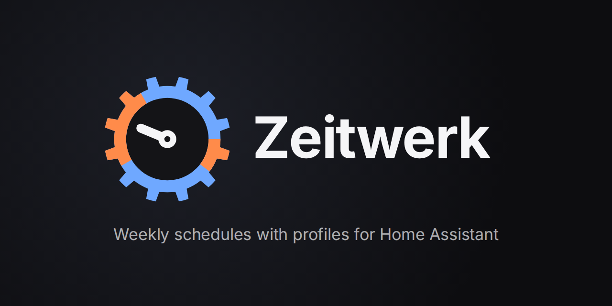
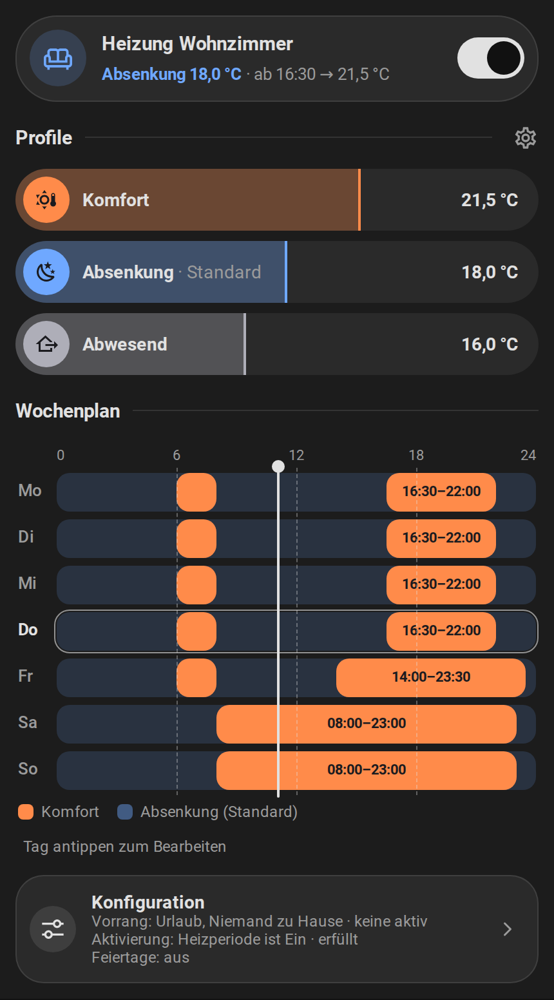
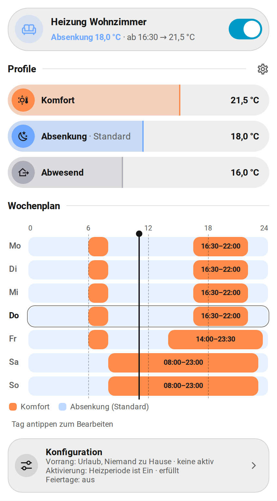
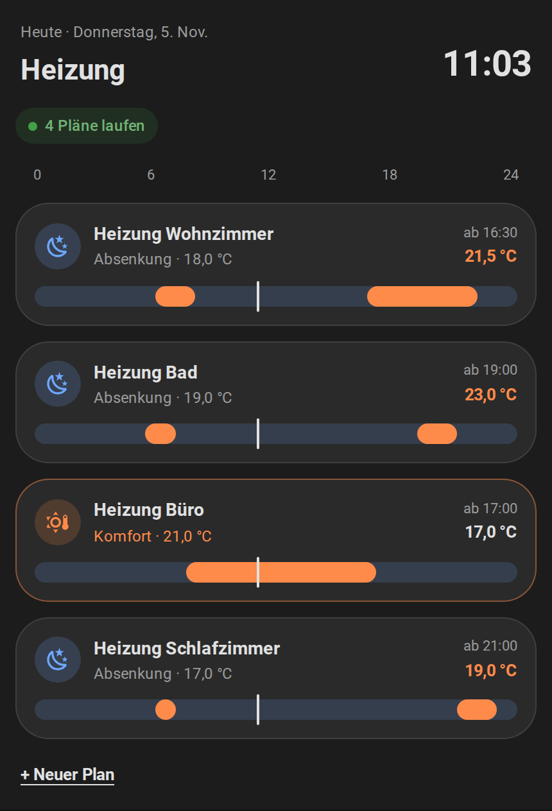
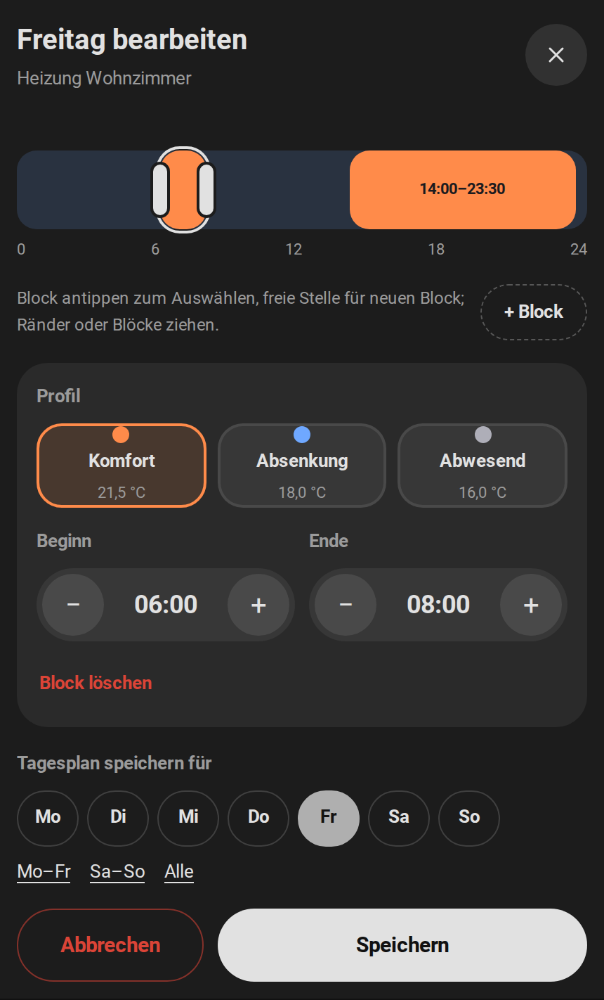
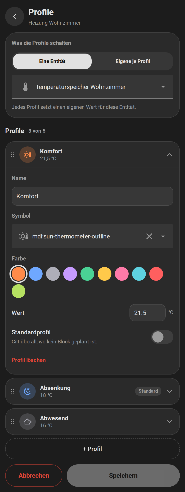
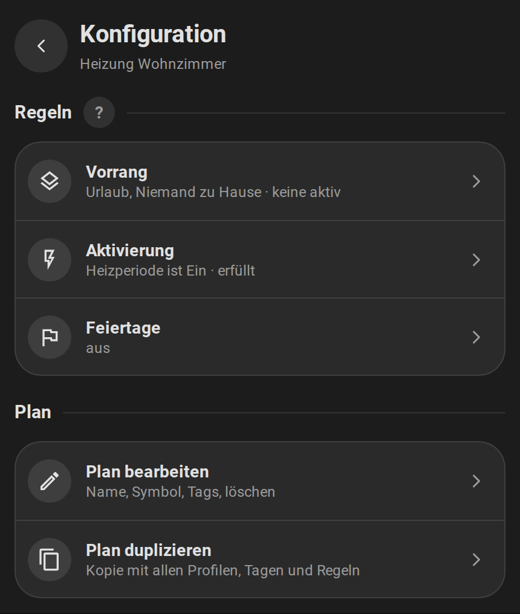

<p align="center">
  
</p>

# Zeitwerk

Weekly schedules for Home Assistant built on **profiles** – like a thermostat
week program, but for any entity.

> **Status:** release candidate for 1.0 – feature complete, being tested in
> real installations. Please report problems via
> [GitHub issues](https://github.com/StiviDrum/zeitwerk/issues) (with diagnostics).

<p align="center">
  
  
  
</p>
<p align="center">
  
  
  
</p>

A plan says *when* a profile applies (week grid with day types such as
"workday" / "weekend" / "holiday"); a profile says *what* happens (any Home
Assistant actions, e.g. set a temperature). Overrides with priority
("vacation → away", "nobody home → away") and activation conditions are built
in. Zeitwerk ships its own Lovelace card, which registers itself – no manual
resource needed. All editing happens in a **sidebar panel** for admins.

## How it decides

For every enabled plan, in this order:

1. Activation conditions not met → plan is *inactive* (does nothing, or applies
   `when_inactive: profile:<id>` once).
2. A forced profile (`zeitwerk.force_profile` / `skip_next`) is active → that profile.
3. First override whose conditions match (list order = priority) → its profile.
4. The block of the current day type → its profile.
5. Otherwise the plan's `default_profile`.

Profiles are applied **only when the result changes** (plus on start with
`reapply_on_start`, and after editing the active profile with
`reapply_on_profile_change`). Blocks with `end <= start` run across midnight
and keep the day type of their start day. Holidays (Holiday calendar or
Workday sensor) can be treated like a weekday (`like_day`) or as an own day
type (`own_day_type`).

Daylight saving time: a block starting inside the skipped hour (e.g. 02:30 in
March) starts at 03:00; during the repeated hour in October the state of the
end of the first pass is kept, so nothing switches twice.

## Installation (HACS, custom repository)

Requires Home Assistant 2026.11 or newer.

1. HACS → ⋮ → *Custom repositories* → `https://github.com/StiviDrum/zeitwerk`, type **Integration**.
2. Install **Zeitwerk**, restart Home Assistant.
3. *Settings → Devices & services → Add integration → Zeitwerk*.

## Sidebar panel

Zeitwerk adds an entry **Zeitwerk** to the sidebar. It is visible to admin users
only and is where everything is edited. The card only displays and controls
(see [Card](#card)). On narrow screens (phone, Companion app) the panel uses a
single column.

- **Overview** (`/zeitwerk`): a plain list of all schedules (plans), with the
  button „Add plan“.
- **Week plan** (`/zeitwerk/plan/<plan_id>`): the week grid. Tap a day to open
  the **day editor** (`/zeitwerk/plan/<plan_id>/day/mon`): all blocks of that
  day on a 24 h bar – tap a block to select it, tap an empty spot or „+ Block“
  to add one, drag the handles or the block (snapped to the plan's time step),
  change profile and times (± buttons or type them: „7“, „730“, „7:30“; Enter
  applies, Esc cancels), delete. Blocks stay within the day (0:00–24:00).
  Resume points („Rücksetzpunkte“) are set here too: drag the knob above the
  day bar or type the time. On **Save** pick further days (Mo–So, quick Mo–Fr /
  Sa–So / Alle) that get exactly this day plan – their old blocks are replaced.
  Weekdays with the same plan are grouped into day types automatically (so
  `day_type` attributes show names like „Mo–Fr“).
- **Rules** (`/zeitwerk/plan/<plan_id>/rules`, „?“ explains them): **Overrides**
  in priority order with a live *active* badge – drag the handle (or focus it
  and press ↑/↓) to reorder, tap to edit name, profile, all/any and conditions
  (Home Assistant's own condition editor; JSON fallback if it cannot be
  loaded). **Activation**: all/any, live ✓ per condition, "otherwise" behaviour
  (`when_inactive`) and immediate re-evaluation (`reevaluate`). A paused plan
  shows the reason in the header, e.g. „pausiert – Heizperiode: Aus“.
  **Holidays**: source (Holiday calendar or Workday sensor), mode off / like a
  weekday / own day (creates a „Feiertag“ day type with its own row and tab)
  and the next three holidays. **Options**: the time step for the editors
  (`options.time_step`: 5, 10, 15, 30 or 60 minutes, default 15).
- **Profiles** (`/zeitwerk/plan/<plan_id>/profiles`): name, icon, colour, default
  profile (exactly one; it applies wherever no block is planned) and 1–5
  profiles; drag the handle (or ↑/↓) to change their order (= slider order).
  What the profiles switch: either **one entity for all** (each profile sets its
  own value – temperature, option, on/off, brightness …) or **own entities per
  profile**, each profile with one or more „entity → value“ lines (e.g. Morning:
  light A on – Evening: light B on and light A off). Anything else can be edited
  as actions with Home Assistant's action editor. Deleting a profile: its blocks
  disappear (the default profile applies there) and rules using it switch to the
  default profile.
- **Plan** (on the rules page): edit plan (name, icon, tags; the plan id stays,
  so cards and automations keep working), **delete plan** (confirmation) and
  **duplicate plan** (also as „Vorlage“ in the new-plan wizard): copies
  everything; the copy starts switched off so two plans never control the same
  entities.
- **New plan** (`/zeitwerk/new`): „+ Neuer Plan“ in the overview or in the card.
  Name, icon, tags and the profiles with the editor described above, plus a
  start layout (workday/weekend or every day). The plan name is suggested from the chosen entity. Or start from
  an existing plan („Vorlage“, the copy starts switched off). A card configured
  with an unknown `plan:` id offers to create the plan under that id.
- After every change „Gespeichert · Rückgängig“ is shown for 10 s. Undo is
  refused if the plan was changed elsewhere in the meantime.

The panel is loaded only when its sidebar entry is opened.

## Card

The integration serves the card and registers it with the frontend itself –
no dashboard resource needed. Add it via *Edit dashboard → Add card → Zeitwerk*
(the picker preview shows your first plan; all options are available in the
visual editor) or in YAML:

```yaml
type: custom:zeitwerk-card
view: week                  # week | timeline | profiles
plan: wohnzimmer_heizung    # plan id (week view)
show_profile_sliders: true  # quick view of the profile values
compact: false              # hides sliders/legend, smaller grid
```

`view: profiles` is the quick view: the profile values with their sliders.

Timeline of all plans (optionally filtered by tag):

```yaml
type: custom:zeitwerk-card
view: timeline
plans: [heizung_wohnzimmer, heizung_bad]  # optional; only these plans, in this order
tags: [heizung]   # optional; plans with any of these tags
title: Heizung    # optional
```

The card displays and controls; it does not edit. Editing happens in the
[sidebar panel](#sidebar-panel).

- **Header** with the current profile and value, the next change and the plan
  on/off switch. Only when the plan deviates from the week plan a quiet line
  says why („Vorrang: Urlaub“, „manuell bis 22:00“, „Komfort bis 22:00“,
  „Feiertag“). A manual override shows „manuell bis 22:00“ and
  **„Fortsetzen“** next to it (and the ▷ button in the timeline) ends a manual
  override or forced profile and returns to the schedule right away
  (`zeitwerk.resume`).
- **Profile sliders** for profiles that set exactly one value on one entity
  (`input_number`/`number` value, climate temperature, select option,
  brightness, position, percentage, on/off). Dragging calls
  `zeitwerk.set_profile_value` (debounced 400 ms; on touch screens the slider
  reacts only after a short hold, so scrolling never changes a value); on/off
  profiles are switched via the websocket API (admin).
- **Week grid** (display only) with a now-line and the resume points as dotted
  lines; block labels adapt to the available width („06:00–08:00“, „06:00“ or
  none – hover shows the span). Today's row is outlined. For admins, tapping a
  day opens its day editor in the panel.
- **Timeline**: one band per plan for today (scheduled blocks, manual override
  hatched, now-line), the current profile and value and the next change („ab
  22:00“ / „in 20 min“); plans not in their default profile get a border in the
  profile colour. Tapping a plan opens its week view in the same card; „‹
  Zeitpläne“ goes back.
- **Admins** get „In Zeitwerk bearbeiten“ (opens the plan in the panel) and
  „+ Neuer Plan“ (opens the wizard in the panel).
- Changes made in the card (e.g. a slider) offer „Gespeichert · Rückgängig“ for
  10 s.
- `time_step` in the card is ignored. The time step is a plan option now
  (`options.time_step`, set on the rules page of the panel).

Bundle size (minified, 1.0 build): card 95 059 bytes, panel 184 488 bytes.

## Repairs

If a plan refers to entities that do not exist (profile targets, conditions,
holiday source), Zeitwerk raises a warning under *Settings → Repairs* naming
the plan and the missing entities. It disappears when the entities exist again
(checked on start, on plan changes and when the entity registry changes).

## Diagnostics and bug reports

*Settings → Devices & services → Zeitwerk → ⋮ → Download diagnostics* (all
plans) or the same on a plan's device page (one plan) gives a JSON file with
the plan, its current status, the stored runtime state and the versions.
Please attach it to [bug reports](https://github.com/StiviDrum/zeitwerk/issues/new/choose).
It contains your plan, profile and rule names and the entity ids used in them.

## Manual changes

`options.manual_override` decides what happens when someone changes a target
value by hand (any change whose context does not come from Zeitwerk):

| Value | Behaviour |
|---|---|
| `until_next` (default) | keep the manual value until the effective profile changes (next block, override, activation); no re-apply on restart or profile edit meanwhile |
| `ignore` | no detection; re-applies (restart, profile edit) overwrite the manual value |
| `minutes:<n>` | keep the manual value for *n* minutes (also across profile changes), then apply the current profile again |

Only the value a profile actually sets is watched (e.g. the climate
`temperature` attribute, not `current_temperature`), and a change to exactly
the value of the active profile counts as an echo, not as a manual change.
`zeitwerk.apply`, `zeitwerk.resume` and `zeitwerk.force_profile` end a manual
override. The profile sensor then carries `manual_override`, `manual_since`,
`manual_until`, `manual_entity`, `manual_attribute`.

### Resume points

A day type can have **resume points**: at these times a manual override ends
and the current profile is applied again (whichever comes first – resume
point, profile change or the `minutes:<n>` window). With `resume_forced: true`
they also end a forced profile. Overrides always keep their priority: a
resume point never ends an override, so with „Urlaub“ active the away
profile applies afterwards.

```yaml
week:
  day_types:
    - id: workday
      name: Werktag
      days: [mon, tue, wed, thu, fri]
      blocks: [{ start: "16:00", end: "22:00", profile: comfort }]
      resume_points: ["13:00", "23:00"]   # hand changes end at 13:00 / 23:00
      resume_forced: true                 # …and so does a forced profile
```

Missed while Home Assistant was down → the override ends on the next start.
DST: a point inside the skipped hour fires at the first valid time after it,
in the repeated hour only once.

## Plan format

```yaml
id: wohnzimmer_heizung
name: Heizung Wohnzimmer
profiles:
  - id: comfort
    name: Komfort
    color: "#ff8b4a"
    actions:
      - action: input_number.set_value
        target: { entity_id: input_number.temperaturspeicher_wohnzimmer }
        data: { value: 22 }
  - id: eco
    name: Absenkung
    actions:
      - action: input_number.set_value
        target: { entity_id: input_number.temperaturspeicher_wohnzimmer }
        data: { value: 18 }
default_profile: eco
week:
  day_types:
    - { id: workday, name: Werktag, days: [mon, tue, wed, thu, fri],
        blocks: [{ start: "16:00", end: "22:00", profile: comfort }] }
    - { id: weekend, name: Wochenende, days: [sat, sun],
        blocks: [{ start: "09:00", end: "22:00", profile: comfort }] }
holidays: { source: calendar.deutschland_he, mode: like_day, like_day: sun }
overrides:
  - id: vacation
    name: Urlaub
    profile: eco
    conditions:
      - { condition: state, entity_id: input_boolean.urlaub, state: "on" }
options: { time_step: 15, reapply_on_start: true, reapply_on_profile_change: true }
```

Full model: [docs/SPEC.md](https://github.com/StiviDrum/zeitwerk/blob/main/docs/SPEC.md) §3.

## Entities

Per plan (one device per plan):

| Entity | State | Attributes |
|---|---|---|
| `switch.zeitwerk_<plan>` | plan enabled | – |
| `sensor.zeitwerk_<plan>_profile` | current profile name | `profile_id`, `source` (`schedule`, `default`, `override:<id>`, `forced`, `inactive`, `disabled`), `day_type`, `is_holiday`, `forced_until`, `manual_override`, `manual_since`, `manual_until`, `manual_entity`, `manual_attribute` (watched attribute, e.g. `temperature`; missing when the state itself is watched), `error` |
| `sensor.zeitwerk_<plan>_next_change` | timestamp of next scheduled change (empty while an override is active) | `next_profile`, `next_profile_name` |
| `binary_sensor.zeitwerk_<plan>_active` | activation conditions met | `match`, `conditions` (each with `result`) |

## Services

| Service | Fields | Purpose |
|---|---|---|
| `zeitwerk.apply` | optional `plan` (one or a list; empty = all) | run the current profile's actions again and end a manual override (disabled plans are skipped) |
| `zeitwerk.enable` / `zeitwerk.disable` | optional `plan` (one or a list; empty = all) | switch plans on / off |
| `zeitwerk.duplicate_plan` | `plan`, optional `name`, `new_plan` | copy a plan (starts switched off), returns `plan_id` |
| `zeitwerk.set_profile_value` | `plan`, `profile`, `value`, optional `entity_id`, `key` | change a profile value (e.g. Comfort → 21 °C) |
| `zeitwerk.skip_next` | `plan` | keep the current profile through the next change |
| `zeitwerk.force_profile` | `plan`, `profile`, optional `duration` | force a profile (default: until the next change) |
| `zeitwerk.clear_force` | `plan` | end a forced/skipped profile |
| `zeitwerk.resume` | optional `plan` (one or a list; empty = all) | end a manual override **and** a forced profile, apply the schedule now (overrides keep priority) |
| `zeitwerk.get_plan` | optional `plan` | **response data**: whole plan(s) incl. `days` (blocks per weekday), `resume` (resume points per weekday), overrides, activation, holidays, status |
| `zeitwerk.set_day_plan` | `plan`, `days`, `blocks`, optional `resume_points`, `resume_forced` | set exactly these blocks (and resume points, if given) on the given days (like the day editor) |
| `zeitwerk.set_override` | `plan`, optional `override_id`, `name`, `profile`, `match`, `conditions`, `position` | create or change an override (position 0 = top) |
| `zeitwerk.remove_override` | `plan`, `override_id` | delete an override |
| `zeitwerk.update_plan` | `plan` + any of `name`, `icon`, `tags`, `enabled`, `profiles`, `default_profile`, `activation`, `holidays`, `options` | change parts of a plan (`activation`/`holidays`/`options` are merged) |
| `zeitwerk.create_plan` | `plan` (object) | create a plan, returns `plan_id` |
| `zeitwerk.delete_plan` | `plan` | delete a plan |

A plan has 1–5 profiles; when `update_plan` removes a profile, its blocks are
dropped and rules using it switch to the default profile.

Editing services (`set_*`, `remove_override`, `update_plan`, `create_plan`,
`duplicate_plan`, `delete_plan`) need an admin user; calls from automations (no user) are
allowed. The profile sensor additionally exposes `plan_id`, `profiles`
(id → name) and `overrides` (with `active`).

```yaml
# Somebody turned the thermostat up by hand: back to the schedule for all plans
action: zeitwerk.apply
---
# Summer: pause all heating plans
action: zeitwerk.disable
data:
  plan: [wohnzimmer_heizung, bad_heizung]
---
action: zeitwerk.force_profile
data:
  plan: wohnzimmer_heizung
  profile: comfort
  duration: "02:00:00"
```

```yaml
# Geofencing sets input_boolean.claude_heizung_abgesenkt; Zeitwerk lowers the heating
action: zeitwerk.set_override
data:
  plan: wohnzimmer_heizung
  name: Niemand zu Hause
  profile: away
  conditions:
    - condition: state
      entity_id: input_boolean.claude_heizung_abgesenkt
      state: "on"
---
action: zeitwerk.set_day_plan
data:
  plan: wohnzimmer_heizung
  days: [mon, tue, wed, thu, fri]
  blocks:
    - { start: "06:00", end: "08:00", profile: comfort }
    - { start: "16:00", end: "22:00", profile: comfort }
```

### Using Zeitwerk with an assistant (e.g. Claude via MCP)

Everything the card can do is available as a service, and the service
descriptions explain the concepts, so an assistant connected to Home
Assistant can operate Zeitwerk on its own: read a plan with `get_plan`
(response data), then change days, overrides, activation or holidays with
the editing services. Keep delays (e.g. "away for 15 min") in the helper or
geofencing automation – a `for:` in an override condition is not re-checked
after the delay.

## Websocket API

The card and the sidebar panel use these websocket commands. Creating, updating,
duplicating and deleting plans need an admin user. Read-only fields (e.g.
`status`) are ignored when sent.

| Type | Fields | Purpose |
|---|---|---|
| `zeitwerk/plans/list` | optional `tag` | list plans |
| `zeitwerk/plans/get` | `plan_id` | one plan |
| `zeitwerk/plans/create` | `plan` | create a plan (admin) |
| `zeitwerk/plans/update` | `plan_id`, `plan` | change a plan (admin) |
| `zeitwerk/plans/duplicate` | `plan_id`, optional `name` | copy a plan, which starts switched off (admin) |
| `zeitwerk/plans/delete` | `plan_id` | delete a plan (admin) |
| `zeitwerk/plans/subscribe` | optional `plan_id` | sends `init`, then `added` / `updated` / `removed` |
| `zeitwerk/preview` | `plan_ids`, `tag`, `start`, `end` | scheduled segments, max. 8 days |
| `zeitwerk/holidays/upcoming` | `source`, optional `count` | next holidays of a calendar/Workday source |

## Development

Requirements: Git, Node.js ≥ 20, Python ≥ 3.14.2 (the version current Home
Assistant requires). Recommended: Linux or **WSL2** on Windows (clone the repo
inside the WSL home, e.g. `~/zeitwerk`; `http://localhost:8123` works from the
Windows browser). Native Windows (Git Bash) still works as a fallback – Unix-only
modules are shimmed for local runs only; CI always runs on Linux.

```bash
scripts/setup      # .venv + Python and npm dependencies
scripts/test       # pytest + vitest
scripts/lint       # ruff + eslint/prettier
scripts/develop    # local HA at http://localhost:8123 with ./config (heating test bed)
python scripts/seed_reference_plans.py --token <token>   # creates the 5 heating plans
cd frontend && npm run watch   # rebuilds the card and the panel into custom_components/zeitwerk/frontend/
```

Tests run against Home Assistant 2026.11 (the minimum version) with its
official test package `pytest-homeassistant` (`requirements_test.txt`).

Card preview without Home Assistant (mocked `hass`): build the card, run
`python3 -m http.server 8000` in the repo root and open
`http://localhost:8000/frontend/dev/preview.html` (`?theme=light`, `?lang=en`,
`?admin=0`, `?plan=missing`).

## License

MIT © Steven Glab

---

## Deutsch

Zeitwerk ist eine Home-Assistant-Integration für Wochenpläne mit **Profilen**
(z. B. „Komfort“, „Absenkung“) und eingebauten Vorrang-Regeln (Urlaub,
niemand zu Hause). Die Karte bringt sie selbst mit und registriert sie
automatisch. Bearbeitet wird in einer eigenen **Seitenleiste**.

**Status:** Release Candidate für 1.0 – vollständig, wird im Alltag getestet.

### Wie es entscheidet

Für jeden aktiven Plan gilt diese Reihenfolge:

1. Aktivierung nicht erfüllt → Plan ist *inaktiv* (tut nichts, oder wendet
   `when_inactive: profile:<id>` einmal an).
2. Ein erzwungenes Profil (`zeitwerk.force_profile` / `skip_next`) ist aktiv → dieses Profil.
3. Erste Vorrang-Regel, deren Bedingungen zutreffen (Listenreihenfolge = Priorität) → ihr Profil.
4. Der Block des aktuellen Tagestyps → sein Profil.
5. Sonst das Standardprofil des Plans.

Profile werden **nur bei einer Änderung** angewendet (beim Start mit
`reapply_on_start`, nach Änderung des aktiven Profils mit
`reapply_on_profile_change`). Sommerzeit: Ein Block, der in die übersprungene
Stunde fällt, beginnt um 03:00; in der doppelten Stunde im Oktober bleibt der
Stand vom Ende des ersten Durchlaufs.

### Seitenleiste „Zeitwerk“ (nur Admins)

Zeitwerk hat einen eigenen Eintrag in der Seitenleiste. Dort wird alles
bearbeitet; die Karte zeigt an und bedient nur.

- **Übersicht** (`/zeitwerk`): alle Zeitpläne als einfache Liste, mit dem Knopf
  „Plan hinzufügen“.
- **Plan** (`/zeitwerk/plan/<plan_id>`): Wochenraster. Tippen auf einen Tag
  öffnet den **Tages-Editor** (`/zeitwerk/plan/<plan_id>/day/mon`): alle Blöcke
  des Tages auf einem 24-h-Balken. Block antippen zum Auswählen, leere Stelle
  oder „+ Block“ zum Hinzufügen, Griffe oder Block ziehen (auf die Schrittweite
  des Plans eingerastet), Profil und Zeiten ändern (± oder eintippen: „7“,
  „730“, „7:30“; Enter übernimmt, Esc verwirft), löschen. Rücksetzpunkte
  („Rücksetzpunkte“) setzt man hier ebenfalls. Beim **Speichern** wählt man
  weitere Tage (Mo–So, schnell Mo–Fr / Sa–So / Alle), die genau diesen
  Tagesplan erhalten – ihre alten Blöcke werden ersetzt. Wochentage mit gleichem
  Plan werden automatisch zu Tagestypen zusammengefasst (z. B. „Mo–Fr“).
- **Regeln** (`/zeitwerk/plan/<plan_id>/rules`, „?“ erklärt sie): **Vorrang-Regeln**
  in Prioritätsreihenfolge mit Live-Badge *aktiv* – ziehen (oder Griff fokussieren
  und ↑/↓) zum Sortieren, antippen zum Bearbeiten von Name, Profil, alle/eine und
  Bedingungen (HA-Bedingungseditor). **Aktivierung**: alle/eine, Live-✓ je
  Bedingung, „Sonst“-Verhalten (`when_inactive`) und sofortige Neubewertung
  (`reevaluate`). **Feiertage**: Quelle (Feiertagskalender oder Workday-Sensor),
  Modus aus / wie Wochentag / eigener Tag (legt den Tagestyp „Feiertag“ mit
  eigener Zeile und eigenem Reiter an) und die nächsten drei Feiertage.
  **Optionen**: Schrittweite der Editoren (`options.time_step`: 5, 10, 15, 30
  oder 60 Minuten, Standard 15).
- **Profile** (`/zeitwerk/plan/<plan_id>/profiles`): Name, Symbol, Farbe,
  Standardprofil (genau eins; gilt überall ohne geplanten Block) und 1–5 Profile.
  Reihenfolge per Griff (oder ↑/↓) = Reihenfolge der Regler. Was sie schalten:
  **eine Entität für alle** (jedes Profil setzt seinen Wert – Temperatur, Option,
  an/aus, Helligkeit …) oder **eigene Entitäten je Profil** mit einer oder mehreren
  Zeilen „Entität → Wert“ (z. B. morgens Licht A an – abends Licht B an und Licht A
  aus). Alles Weitere als Aktionen im HA-Aktionseditor. Ein gelöschtes Profil
  verliert seine Blöcke (dort gilt das Standardprofil), Regeln mit ihm wechseln
  auf das Standardprofil.
- **Plan** (auf der Regeln-Seite): Plan bearbeiten (Name, Symbol, Tags; die
  Plan-ID bleibt, Karten und Automationen funktionieren weiter), **Plan löschen**
  (mit Bestätigung) und **Plan duplizieren** (auch als „Vorlage“ im Assistenten).
  Die Kopie startet ausgeschaltet, damit nie zwei Pläne dieselben Entitäten steuern.
- **Neuer Plan** (`/zeitwerk/new`): „+ Neuer Plan“ in der Übersicht oder in der Karte.
  Name, Symbol, Tags und Profile wie oben, dazu Start mit Werktag/Wochenende oder
  jeden Tag gleich. Der Plan-Name wird aus der gewählten Entität vorgeschlagen. Alternativ
  als Kopie eines Plans („Vorlage“, die Kopie startet ausgeschaltet). Eine Karte
  mit unbekanntem `plan:` bietet an, den Plan unter dieser ID anzulegen.
- Nach jeder Änderung gibt es 10 s lang „Gespeichert · Rückgängig“. Rückgängig
  ist nicht möglich, wenn der Plan inzwischen woanders geändert wurde.

Bundle-Größen (minifiziert, 1.0-Build): Karte 95 059 Bytes, Seitenleiste 184 488
Bytes. Die Seitenleiste wird erst beim Öffnen geladen.

### Karte

Die Karte bringt sich selbst mit und registriert sich automatisch. Hinzufügen
über *Dashboard bearbeiten → Karte hinzufügen → Zeitwerk* oder in YAML:

```yaml
type: custom:zeitwerk-card
view: week                  # week | timeline | profiles
plan: wohnzimmer_heizung    # Plan-ID (Wochenansicht)
show_profile_sliders: true  # Schnellansicht: Regler für die Profilwerte
compact: false              # blendet Regler/Legende aus, kleineres Raster
```

Die Karte **zeigt an und bedient**, sie bearbeitet nicht. Der Kopf zeigt Profil,
Wert, nächsten Wechsel und den Plan-Schalter; eine manuelle Änderung zeigt
„manuell bis 22:00“ mit **„Fortsetzen“** (Dienst `zeitwerk.resume`). Das
Wochenraster zeigt Rücksetzpunkte als gepunktete Linien. Die Zeitleiste
(`view: timeline`, optional nur bestimmte Pläne mit `plans: [...]` oder
`tags: [heizung]`) zeigt pro Plan ein Band für heute; ein Plan antippen öffnet
seine Wochenansicht in derselben Karte („‹ Zeitpläne“ führt zurück).
`view: profiles` zeigt die Profilwerte mit Reglern. Änderungen an der Karte
(z. B. ein Regler) bieten 10 s lang „Rückgängig“.

Für Admins gibt es „In Zeitwerk bearbeiten“ (öffnet den Plan in der Seitenleiste),
„+ Neuer Plan“ und ein Antippen eines Tages im Wochenraster öffnet dessen
Tages-Editor in der Seitenleiste. Die Kartenoption `time_step` wird ignoriert; die
Schrittweite ist jetzt eine Plan-Option (Regeln-Seite der Seitenleiste).

### Weitere Abschnitte

Pro Plan gibt es einen Schalter (Plan an/aus), einen Profil-Sensor, einen
Sensor „Nächster Wechsel“ und einen Binärsensor „Aktiv“. Dienste:
`zeitwerk.apply` (ohne Plan: alle; setzt nach einer Handänderung wieder die
Planwerte), `enable`/`disable` (ohne Plan: alle), `set_profile_value`,
`skip_next`, `force_profile`, `clear_force`, `resume`.

Websocket-Befehle `zeitwerk/plans/*` (Anlegen, Ändern, Duplizieren und Löschen
nur für Admins) – die Karte und die Seitenleiste nutzen sie.

Voraussetzung: Home Assistant 2026.11 oder neuer. Installation über HACS →
Benutzerdefinierte Repositories → Typ *Integration*,
danach unter *Einstellungen → Geräte & Dienste* „Zeitwerk“ hinzufügen.

Manuelle Änderungen (`manual_override`): `until_next` hält den Handwert bis
zum nächsten Profilwechsel, `minutes:<n>` für n Minuten, `ignore` erkennt
nichts.

**Rücksetzpunkte** (Tages-Editor in der Seitenleiste, je Tag, mit „Tagesplan
speichern für“ auf mehrere Tage übertragbar; Griff über der Tagesleiste ziehen
oder Uhrzeit eintippen): Zu diesen Uhrzeiten endet eine manuelle Änderung,
und der Zeitplan läuft weiter. „Auch erzwungenes Profil“ beendet dort auch ein
erzwungenes Profil. Vorrang-Regeln (Urlaub, Abwesend) behalten immer ihren
Vorrang. **„Fortsetzen“** in der Karte (Dienst `zeitwerk.resume`) kehrt sofort
zum Zeitplan zurück.

Fehler bitte als [GitHub-Issue](https://github.com/StiviDrum/zeitwerk/issues/new/choose)
melden, mit Diagnose-Datei (*Geräte & Dienste → Zeitwerk → ⋮ → Diagnose
herunterladen*). Fehlende Entitäten in einem Plan erscheinen unter
*Einstellungen → Reparaturen*.

Alles, was die Seitenleiste kann, gibt es auch als Dienst (`zeitwerk.get_plan`,
`set_day_plan`, `set_override`, `remove_override`, `update_plan`,
`create_plan`, `duplicate_plan`, `delete_plan`, `enable`, `disable`,
`apply`) – damit können Automationen oder ein Assistent
wie Claude (über MCP) Zeitwerk vollständig bedienen, z. B. eine Vorrang-Regel
„Geofencing-Helfer an → Abwesend“ anlegen.
